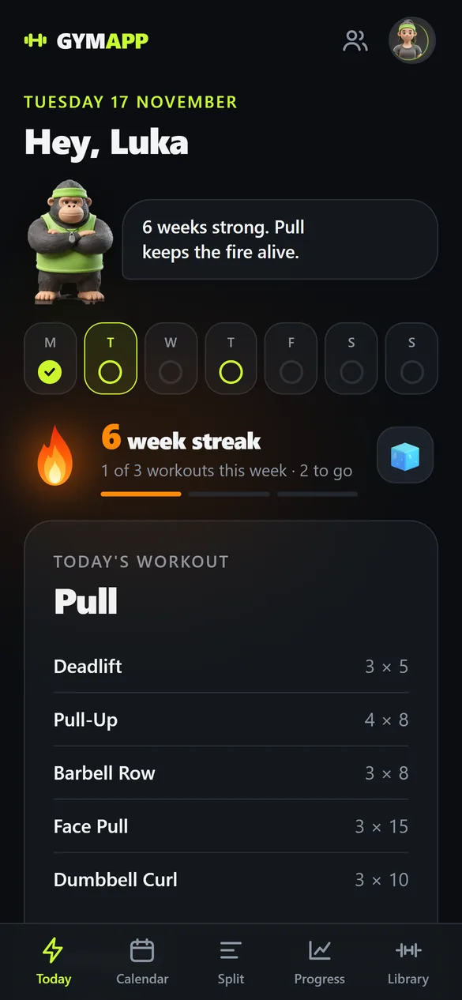
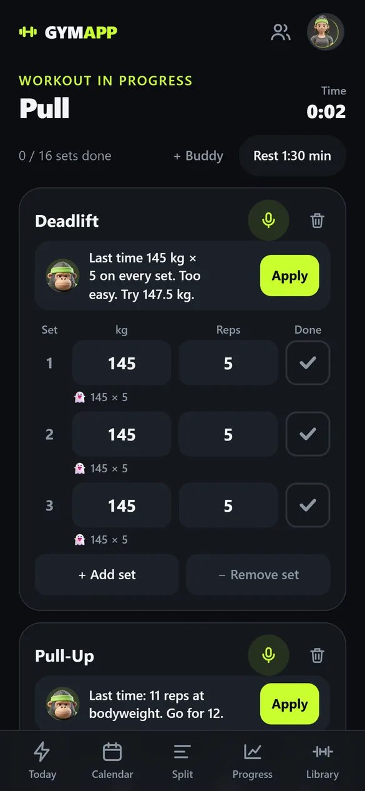
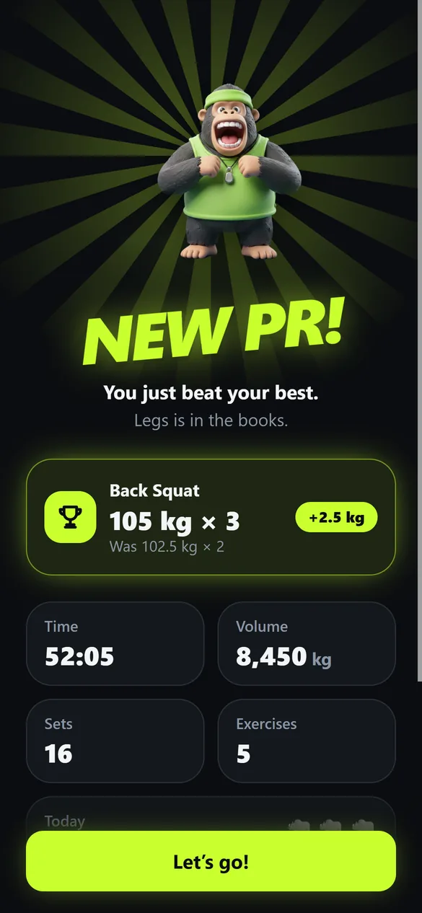
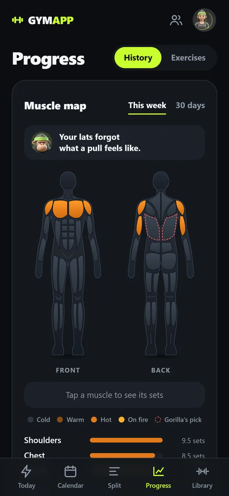
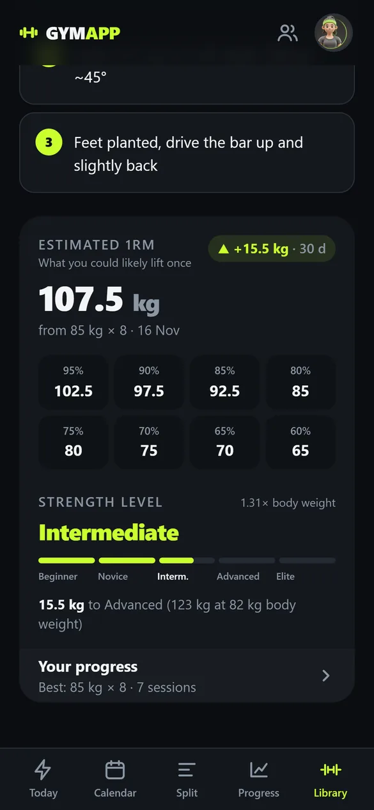
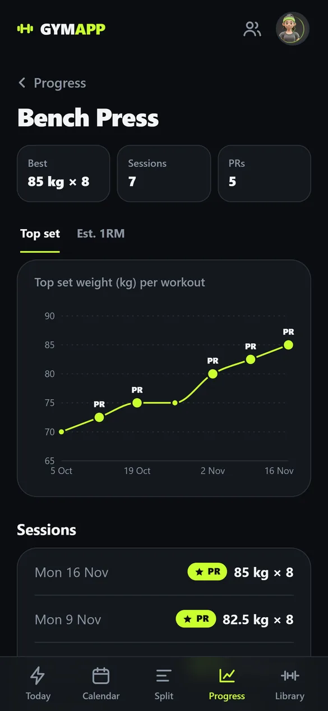
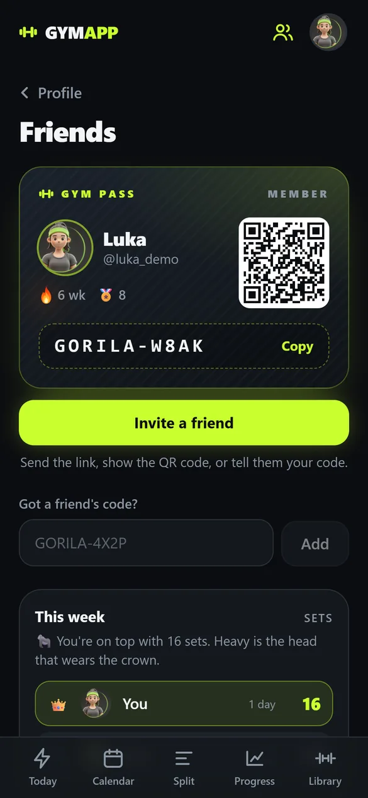
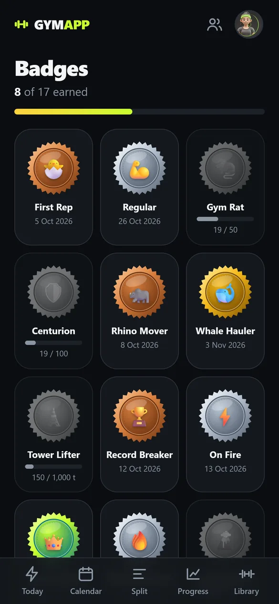
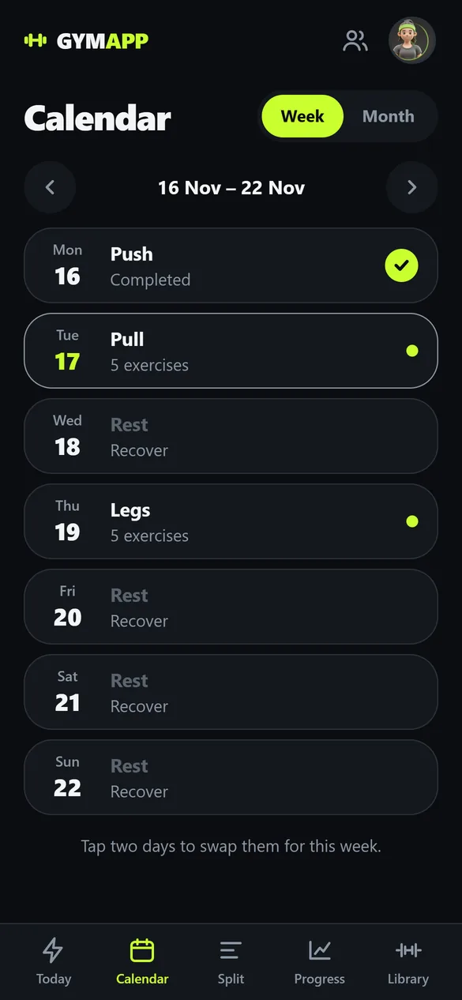
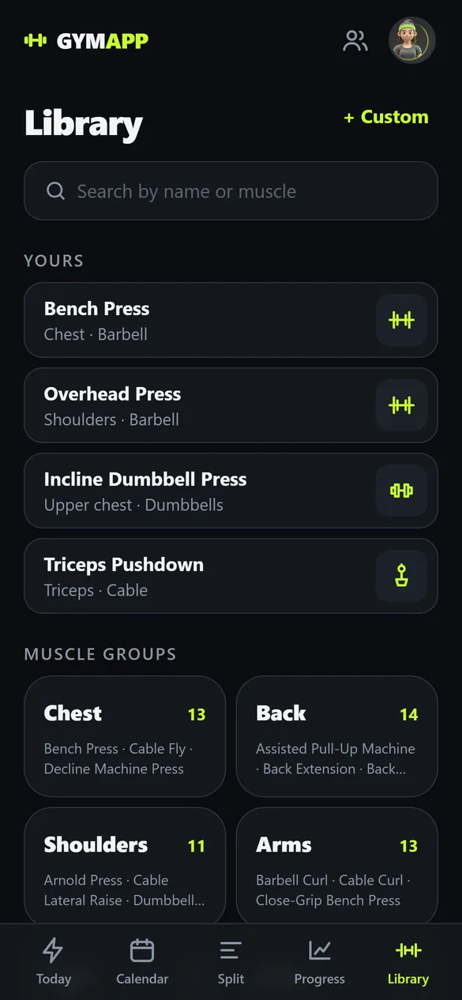

# Gym App

A mobile-first workout tracker: pick a split, see your week, log sets with a rest timer,
and watch your top sets climb.

**Live:** https://ricciricch.github.io/gym-app/

<table>
  <tr>
    <td align="center"><br><sub>Today</sub></td>
    <td align="center"><br><sub>Workout</sub></td>
    <td align="center"><br><sub>New PR</sub></td>
    <td align="center"><br><sub>Muscle map</sub></td>
  </tr>
  <tr>
    <td align="center"><br><sub>1RM + strength level</sub></td>
    <td align="center"><br><sub>Progress chart</sub></td>
    <td align="center"><br><sub>Friends</sub></td>
    <td align="center"><br><sub>Badges</sub></td>
  </tr>
  <tr>
    <td align="center"><br><sub>Calendar</sub></td>
    <td align="center"><br><sub>Library</sub></td>
    <td></td>
    <td></td>
  </tr>
</table>

<sub>Screens from a demo account with made-up workouts, at phone size.</sub>

## Features

- **Splits** – start from a preset (Push/Pull/Legs, Upper/Lower, Full Body, Bro Split) or
  from scratch. Move days between weekdays, set default exercises with sets × reps.
- **Build my split** – tap the days you can train, pick a goal (strength, muscle, fitness) and how
  long a workout may take, and get a split that never trains the same muscle two days in a row,
  with the reasons spelled out. Muscles you have been skipping get first pick and an extra set.
- **Rotating cycle** – not tied to weekdays? Switch the split to rotating (Push, Pull, Legs,
  rest, repeat). The plan waits for you: skip a day and everything moves one day later instead
  of being lost, and the streak target follows the cycle's pace.
- **Calendar** – week and month views, completed workouts marked, swap two days for the
  current week only (stored as overrides, your split stays untouched).
- **Today** – one big "Start workout" button for whatever is scheduled, or "Train anyway"
  on a rest day.
- **Workout logging** – prefilled from your last session, reps × weight, one tap to mark
  a set done, add/remove sets and exercises, and an offer to update the day's defaults
  when you finish. The draft survives reloads (localStorage).
- **Rest timer** – starts automatically after a set, ±15 s, adjustable default, or switched
  off if you don't time rest. The phone vibrates when it is over; with notifications allowed
  it also does with the screen off.
- **Works offline** – a small hand-written service worker precaches the whole app (the
  file list is generated at build time), and the last loaded data is kept on the phone, so
  the app opens and shows your split and history with no signal. Log the workout
  offline and tap Finish once you are back online.
- **Celebrations** – finishing a workout shows a summary; beating a record sets off
  confetti, a "NEW PR!" stamp and the gain over your previous best.
- **Streak** – a burning flame for every week in a row that you hit all your planned
  workouts; rest days never break it.
- **Progress** – workout history, and a top-set chart per exercise with PR markers.
- **A coach with moods** – the gorilla mascot lives on Today: waiting for your workout,
  beating its chest after a PR, sulking on the couch with chips when you skip a day, and
  not above a little trash talk ("Skipped legs again? 🦵🐔").
- **Coach tips and your ghost** – during a workout the coach suggests the next step from
  your last session ("80 kg × 8 on every set. Too easy. Try 82.5 kg.", one tap to apply), and
  every set shows what you did last time so you can race your past self.
- **Fuel check** – after a workout, tap what you had before it (coffee, carbs, an energy drink,
  nothing). After a few sessions the gorilla tells you what actually works for you ("With coffee
  you lift 8% more").
- **Friends** – add each other with a personal code, an invite link or the QR code on your
  "gym pass"; see each other's streak and badges (never weights), a weekly table of who logged
  the most sets, and nudge a friend who is skipping (their gorilla passes it on). Friends
  with no workout for 10+ days fold into a "Quiet lately" section.
- **Feed and proof photo** – after a workout the gorilla asks for proof: a camera (selfie or flip to
  the back one) with a 3-2-1 countdown and a shutter, and the shot develops like an instant print. Post it (or just
  the stats) for your friends, who can react; posts show no weights and disappear after 30 days.
  The newest prints sit in a row at the top of the Friends page; tap one to open the feed.
- **Exercise library** – 83 popular exercises (machines included) with form cues, searchable and filterable by
  muscle group (also when adding an exercise to a day or a workout). Your own exercises on top,
  muscle group tiles, and an icon for the gear each exercise needs.
- **Muscle map** – a body figure on Progress lights up by how much each muscle was trained
  this week; the gorilla calls out what you skipped ("Your hamstrings filed a missing person
  report.").
- **Badges** – 17 medals to collect (first workout, 100 tonnes lifted, 10 PRs, a 4 week
  streak, a 6 AM session...). A new one drops onto the screen spinning like a coin, then flies
  onto your badge shelf.
- **Streak freeze** – sick or travelling? Freeze the week once a month and the streak
  survives (the flame turns to ice).
- **What you lifted** – your volume in real-world things: "That's like lifting 3 rhinos"
  after a workout, and a year-to-date total (grand pianos, blue whales, Eiffel Towers…).
- **Voice input** – tap the mic and say "sto kila puta pet" (or "100 kilos times 5"): the
  next set is filled in and ticked off. Serbian, Croatian and English.
- **Movement figures** – every exercise has a small animated line figure showing the movement
  (drawn in code from joint angles, no images), on the exercise page and in the lists.
- **Estimated 1RM** – the exercise page estimates your one-rep max from your best set, shows
  how much it grew in 30 days and a 60-95% table for planning sets; the chart can switch
  between top set and estimated max.
- **Strength levels** – add your body weight (only you see it) and bench, squat, deadlift
  and overhead press are placed on a Beginner to Elite scale, with the kilos left to the next
  level and your weakest lift.
- **Privacy** – choose what friends see (when you train, your streak, your badges and records),
  turn off friend requests or nudges, get a new friend code, or skip the photo step after a
  workout. Enforced in the database, not just hidden in the app; weights are never shared.
- **Notifications** – turn them on per phone and hear right away when a friend nudges you,
  sends or accepts a friend request, or reacts to your post; each kind has its own switch.
  A workout reminder at the time you pick (only on planned days you have not trained yet), and
  a warning when your streak needs a workout on every day left in the week.
  Built on standard Web Push (on iPhone: add the app to the Home Screen first).
- **Training together** – mark a friend you trained with; both of you see how many workouts
  you have done together.
- **Your look** – pick a character avatar or upload your own photo (cropped and shrunk on
  the phone before upload); change it any time from your profile.
- **Themes** – five accent colors (Lime, Ember, Electric blue, Violet, Gold) on the same dark
  app, picked on your profile and applied before the first paint, so there is no flash.

## Stack

Vite · React 19 · TypeScript · Tailwind CSS v4 · React Router · TanStack Query ·
Recharts · Supabase (Postgres, Auth, Row Level Security) · Vitest · GitHub Pages.

## Run locally

```bash
npm install
cp .env.example .env   # fill in your Supabase URL + publishable key
npm run dev            # http://localhost:5173/gym-app/
```

Other scripts: `npm run build`, `npm run typecheck`, `npm run lint`, `npm test`.

The database schema lives in `supabase/migrations/`. Apply it to a fresh Supabase project
before running the app.

## Security

- Row Level Security is enabled on every table; each user can only read and write their
  own rows (core exercises are read-only for everyone signed in).
- Only the publishable key ships to the browser. `.env` is never committed; CI reads the
  public URL and key from repository variables.
- Supabase security advisors are run after every schema change.
- Account deletion runs in an Edge Function with the service role, which never reaches the
  client; it deletes only the user identified by the request's JWT, photos included.
- Friends see each other only through database functions that respect each user's privacy
  settings; nobody can list profiles or read another user's workouts directly.
- Push notifications are sent by an Edge Function that only database triggers can call (a
  shared secret kept in Supabase Vault, like the private VAPID key). Messages carry a name and
  a short line, never weights; dead subscriptions are removed automatically.
- Profile photos live in a storage bucket where each user can only write to their own
  folder; only small WebP/JPEG images are accepted.

## How I built it

Built with [Claude Code](https://claude.com/claude-code) as a pair, milestone by milestone
(see [`PLAN.md`](PLAN.md)):

1. **Plan first.** `PLAN.md` fixed the MVP scope and a data model that leaves room for
   friends and a feed later (every row has an explicit `user_id`), without building them.
2. **Schema + RLS before UI.** One migration with policies on every table, then the
   Supabase security advisors until they came back clean.
3. **Pure logic, tested.** Scheduling (weekday layout, swaps, month grid), workout parsing
   and PR detection live in `src/lib/` as plain functions with Vitest tests.
4. **Verify in a real browser.** Every milestone was clicked through at a 375 px phone
   viewport before committing. That's how a `position: fixed` bug inside a transformed
   page wrapper turned up (fixed by portalling sheets and the rest timer to `<body>`).
5. **Art direction.** The mascot and the avatars are generated with Higgsfield from a single
   chosen style and stored locally as WebP (prompts in [`docs/prompts.md`](docs/prompts.md)).
   Generated exercise images were later replaced by animated figures drawn in code, which
   cover all 83 exercises and always show the right form.
